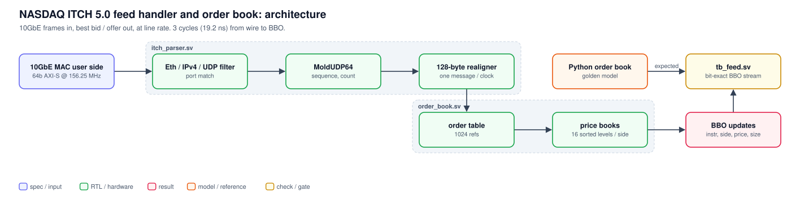
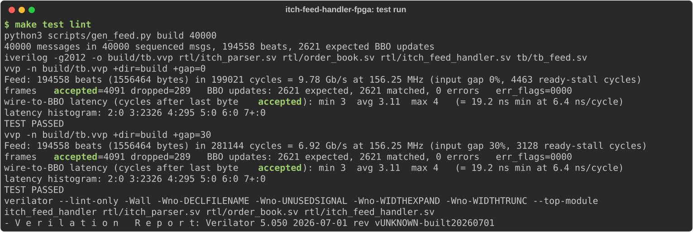

# Low-latency NASDAQ ITCH 5.0 feed handler and order book

[](https://github.com/Ana2601/itch-feed-handler-fpga/actions/workflows/ci.yml)

The FPGA market-data pipeline used in electronic trading: 10GbE frames in, best bid/offer (BBO) updates out, at line rate, with a measured wire-to-BBO latency.

## Pipeline



- The realignment buffer presents every message byte-aligned no matter where it fell in the 64-bit beats
- Price-level insert, update and remove are single-cycle, using a parallel compare-and-shift across all 16 levels
- Replace takes two book operations (delete + add) and stalls the parser for one cycle
- Untracked instruments, unknown order references, other ITCH message types, frames for other UDP ports and non-IP frames are all filtered
- Sticky error flags: malformed frame, book overflow, order-table collision, book inconsistency

## Verification

`scripts/gen_feed.py` builds a realistic synthetic feed:

- 40,000 messages across 4 tracked instruments, with a bounded resting book
- partial and full executions, cancels, deletes and replaces (some across price levels)
- noise: untracked symbols, other message types, unknown references, wrong-port and ARP frames
- packing into 1–30 messages per frame

A **plain-Python order book** produces the expected BBO stream. The testbench checks every BBO update (message index, instrument, side, price, size) and measures latency from the beat that carried each message's last byte.

## Results (measured)

| Metric | Result |
|---|---|
| Messages / frames | 40,000 / 4,380 (4,091 accepted, 289 filtered) |
| BBO updates | **2,621 / 2,621 match the golden model, 0 errors, 0 error flags** |
| Throughput (back-to-back input) | **9.78 Gb/s** of 10 Gb/s line rate |
| Wire-to-BBO latency | **3 cycles = 19.2 ns** min, 3.11 avg, 4 max (4 = Replace) |
| With 30 % random input gaps | same results, same latency |

## Run

```bash
make test        # 40k messages, 0 % and 30 % input gaps
make test N=8000 # quicker
make lint
```

## Test run

Output of the CI command (`make test lint`), captured from a local run:



## Limitations / next steps

- Timing closure has not been run in Vivado: the realignment barrel shifter and the 16-level compare-and-shift are the critical paths, and a production build would pipeline them (adding about 1–2 cycles).
- The order table is direct-mapped with a full tag; the generator keeps live orders in distinct slots, and a production design would use a multi-way hash or CAM.
- A fixed 16 price levels per side; no MoldUDP64 gap detection or retransmission request.

## Setup

- [OSS CAD Suite](https://github.com/YosysHQ/oss-cad-suite-build) (Icarus Verilog, Verilator, Yosys)

```bash
make test
make lint
```

The same commands run in CI on every push (`.github/workflows/ci.yml`).
